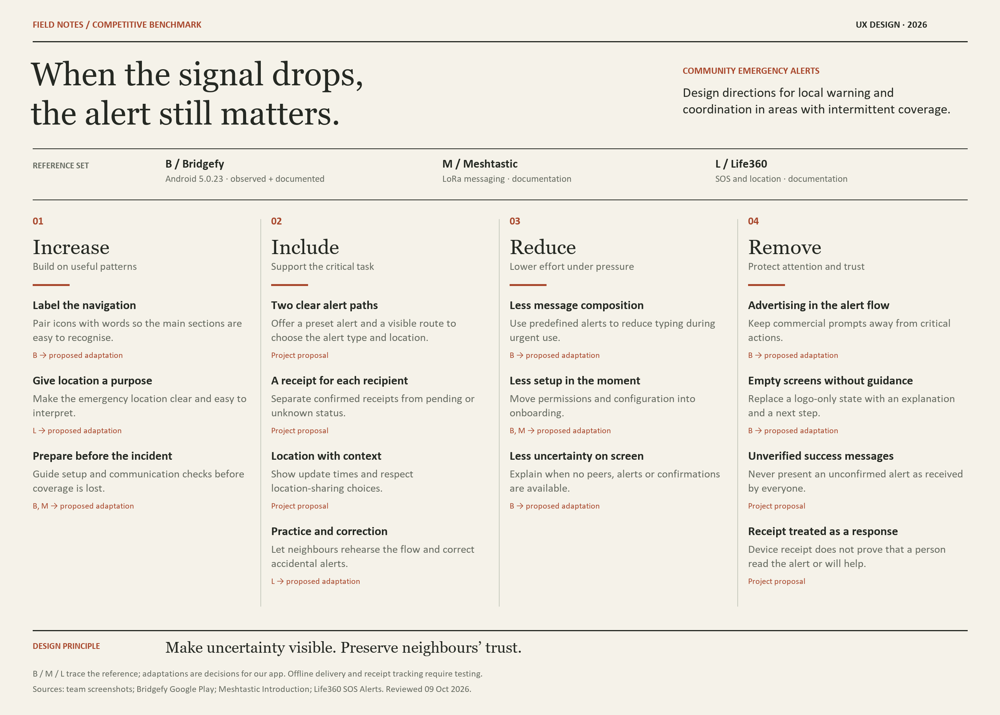
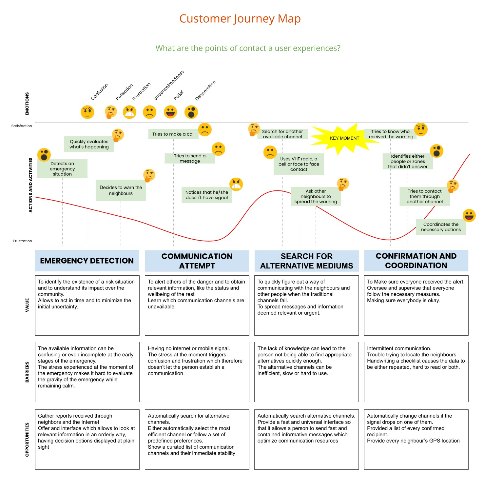

# Neighbourhood Emergency Alerts and Coordination

**Course:** Diseño de Experiencia de Usuario e Interacción Humano Computador — 2026  
**University:** Universidad de La Frontera (UFRO), Temuco, Chile

UX design project for a neighbourhood alert application in areas with unavailable or intermittent mobile coverage.

---

## Index

1. [Introduction](#1-introduction)
2. [Team](#2-team)
3. [Strategy](#3-strategy)
4. [Solution Scope](#4-solution-scope)
5. [Competitive Benchmark](#5-competitive-benchmark)
6. [Customer Journey Map](#6-customer-journey-map)
7. [Repository Contents](#7-repository-contents)

---

## 1. Introduction

In rural areas without reliable mobile coverage, emergency warnings are shared through VHF radio, bells or direct communication between neighbours. These methods help spread information, but make it difficult to know who received a warning and who still needs to be contacted.

A digital solution must treat intermittent connectivity as a normal part of its context of use. It must also explain what happens when delivery cannot be confirmed and reduce false alarms, which can undermine community trust.

> “As the neighbour responsible for alerts in my area, I need to send an emergency warning and know who received it even when the signal is down, so I am not left wondering whether anyone managed to warn others.”

Our project addresses this problem through a proposed application for issuing local alerts and checking receipt confirmations. The design process follows the planes of Jesse James Garrett’s Elements of User Experience.

---

## 2. Team

| Member | Role |
|---|---|
| To be completed | To be completed |

---

## 3. Strategy

The objective is to help neighbours communicate an emergency and understand the reach of a warning, even when connectivity is unstable.

The design priorities are to:

- Make alerts easy to issue under pressure.
- Clearly show received confirmations and pending states.
- Prevent and correct accidental alerts.
- Support different levels of technological experience.
- Support coordination with the communication methods already used by the community.

### 3.1. Value Proposition Canvas

The Canvas connects neighbours’ communication needs with the proposed features. It identifies isolation, ineffective communication and uncertainty about receipt as central difficulties.

The proposal responds through quick alerts, confirmations and local communication. Reaching every neighbour is a user need; achieving it depends on communication conditions and requires validation.

### 3.2. UX Personas

The three design personas represent complementary needs within the project scenario.

| Persona | Profile | Main need |
|---|---|---|
| Mateo Benítez | A 57-year-old farmer and neighbourhood emergency coordinator. | Issue warnings and know who confirmed receipt to organise contact through other channels. |
| Valeria Soria | A 27-year-old rural school assistant. | Receive clear information about what happened, where and what to do. |
| Margarita Muñoz | A 64-year-old farmer. | Receive understandable warnings and ask for help through a simple, accessible interface. |

These profiles guide design decisions and require validation with users from the intended context.

---

## 4. Solution Scope

The proposal is a mobile application with a main button for issuing warnings:

- **Short press:** send an alert preset during profile setup, using the current location.
- **Long press:** select the alert type and specify where the emergency is happening.
- **Local distribution:** attempt to transmit the warning to nearby compatible devices.
- **Tracking:** check received confirmations.
- **Map:** display the emergency and available recipient locations, subject to location-sharing permissions.

The design should provide a visible alternative for accessing custom alerts and evaluate mechanisms for preventing and correcting accidental activation.

### Design Conditions

The communication technology, range and behaviour during interruptions require validation. The interface must distinguish confirmed receipt from the absence of confirmation.

Device receipt does not prove that a person has read the warning or will respond. Locations must indicate when they were updated and respect users’ sharing choices.

The application is intended to support neighbourhood coordination and existing channels, including VHF radio, bells and direct contact.

---

## 5. Competitive Benchmark

The benchmark compares tools that provide references for communication without internet, location sharing and alerts. Its findings support Strategy and Scope decisions.

| Tool | Relevance to the project | Evidence used |
|---|---|---|
| Bridgefy | Communication between nearby phones without internet; partial overlap with the project scenario. | Exploration of Android 5.0.23, team screenshots and documentation. |
| Meshtastic | Decentralised communication through LoRa radios; an alternative requiring additional hardware. | Official documentation. |
| Life360 | Design reference for location sharing, groups of people and SOS alerts. | Official documentation. |

The synthesis organises design decisions into four groups:

- **Increase:** strengthen clear navigation, location context and preparation before an emergency.
- **Include:** add preset and custom alerts, receipt states, location information, and practice and correction mechanisms.
- **Reduce:** decrease typing, setup during an emergency and uncertainty.
- **Remove:** exclude advertising from the critical flow, unexplained empty states and unsupported delivery claims.

Bridgefy observations included labelled navigation icons and organised settings, as well as advertising while connected and a conversations screen without an explanation of its empty state.

[View Bridgefy screenshots](Docs/Benchmark/screenshots/)

Offline delivery, individual confirmations and location updates require further testing. Documentation-based observations do not constitute hands-on validation.

### Sources

- [Bridgefy — Google Play](https://play.google.com/store/apps/details?id=me.bridgefy.main)
- [Meshtastic — Introduction](https://meshtastic.org/docs/introduction/)
- [Life360 — SOS Alerts](https://support.life360.com/hc/en-us/articles/23053474049687-SOS-Alerts)

---

## 6. Customer Journey Map

The map represents the journey of a neighbour trying to communicate an emergency when usual channels fail. It is organised into four stages:

1. **Emergency detection:** identify the risk and decide to warn others.
2. **Communication attempt:** call or send messages and encounter a lack of signal.
3. **Search for alternative channels:** use VHF radio, bells or direct contact.
4. **Confirmation and coordination:** try to establish who received the warning and contact those who did not respond.

The critical moment occurs when the neighbour needs to check the reach of the warning. Uncertainty remains even after transmitting it.

The map identifies opportunities to show confirmations, explain pending states and support coordination through other channels. It represents the scenario analysed by the team and requires validation with users.

---

## 7. Repository Contents

| Folder | Contents |
|---|---|
| `Docs/Value-Proposition/` | Value Proposition Canvas. |
| `Docs/UX-Persona/` | Mateo, Valeria and Margarita’s profiles. |
| `Docs/Benchmark/` | Visual benchmark synthesis. |
| `Docs/Benchmark/screenshots/` | Screenshots from the Bridgefy exploration. |
| `Docs/Customer-journey/` | Customer Journey Map. |